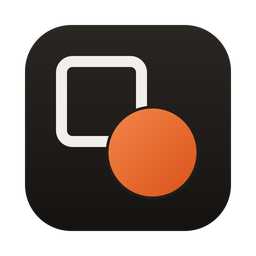

<p align="center">
  
</p>

<h1 align="center">Recast</h1>

<p align="center">
  A free, offline file converter for images, video, GIFs and audio.<br>
  No uploads, no file-size limits, no daily quotas.
</p>

<p align="center">
  
  
  
</p>

---

## Why Recast

Online converters upload your files to someone else's server, then cap how many files or megabytes you can convert so the hosting bill stays manageable. The engines doing the actual work are free and open source, so there is no reason the conversion can't happen on your own machine.

Recast is a small desktop app around [FFmpeg](https://ffmpeg.org):

- **Private:** files never leave your computer. Recast makes no network requests.
- **Unlimited:** convert as many files, as large as you like.
- **All-to-all:** one window for images, video, animated GIFs and audio, including crossovers like video → GIF or video → MP3.
- **Lightweight:** the app itself is about 5 MB. It uses the system webview instead of bundling a browser.

## Features

- Drag and drop files or whole folders into the window (subfolders included), or pick files with the file browser
- Batch conversion with a per-file output format, or **Convert all to…** in one click
- Three quality presets: **High**, **Balanced** and **Small**
- Save next to the original or to a folder of your choice; quality and folder are remembered between launches
- Never overwrites anything: existing names get ` (1)`, ` (2)`… appended
- Live progress for each file, with cancel; quitting mid-conversion stops FFmpeg and removes the partial file
- Transparent images turned into JPG get a white background instead of black
- Light and dark mode follow your system setting

## Supported formats

| Input | Can be converted to |
|---|---|
| **Images:** PNG, JPG, WebP, AVIF, HEIC, TIFF, BMP, TGA, ICO | JPG, PNG, WebP\*, AVIF, GIF, BMP, TIFF |
| **Animated:** GIF, APNG | MP4, WebM, MOV, GIF, animated WebP\*, PNG/JPG (first frame) |
| **Video:** MP4, MOV, MKV, WebM, AVI, M4V, FLV, WMV, MPEG, TS, 3GP, OGV | MP4, MOV, MKV, WebM, AVI, GIF, animated WebP\*, MP3, M4A, WAV, FLAC, Opus, OGG\*, PNG/JPG (first frame) |
| **Audio:** MP3, WAV, FLAC, AAC, M4A, OGG, Opus, WMA, AIFF, AMR | MP3, M4A, WAV, FLAC, Opus, OGG\*, AIFF |

\* Recast checks which encoders your FFmpeg build includes when it starts and only lists formats it can actually produce. Homebrew's default `ffmpeg` lacks WebP and Vorbis (OGG) encoders; `brew install ffmpeg-full` adds them.

### Quality presets

| Output | High | Balanced | Small |
|---|---|---|---|
| MP4 / MOV / MKV (H.264 + AAC) | CRF 18, 192 kbps | CRF 23, 160 kbps | CRF 28, 96 kbps |
| WebM (VP9 + Opus) | CRF 30, 160 kbps | CRF 34, 128 kbps | CRF 40, 80 kbps |
| GIF / animated WebP | 20 fps, ≤ 960 px | 15 fps, ≤ 640 px | 10 fps, ≤ 480 px |
| JPG | q 2 | q 4 | q 8 |
| WebP (image) | 92 | 80 | 60 |
| AVIF | CRF 24 | CRF 32 | CRF 40 |
| MP3 (VBR) | V0 (~245 kbps) | V2 (~190 kbps) | V5 (~130 kbps) |
| M4A (AAC) | 256 kbps | 192 kbps | 128 kbps |
| Opus | 160 kbps | 128 kbps | 64 kbps |

WAV, AIFF, FLAC, PNG, BMP and TIFF are lossless and ignore the preset.

## Installation

Pre-built installers for each platform will be published on the [Releases](https://github.com/miguelsiilva1/Recast/releases) page. Until then, build from source (below).

Recast currently uses the FFmpeg installed on your system:

| OS | Command |
|---|---|
| macOS | `brew install ffmpeg` |
| Windows | `winget install ffmpeg` |
| Debian / Ubuntu | `sudo apt install ffmpeg` |
| Fedora | `sudo dnf install ffmpeg` |

If FFmpeg is missing, the app tells you and shows these commands.

> **Unsigned builds:** the app isn't code-signed yet. On macOS, open it the first time with right-click → **Open**. On Windows, choose **More info → Run anyway** in the SmartScreen prompt.

## Building from source

**Requirements:** [Node.js](https://nodejs.org) 20+, [Rust](https://rustup.rs) (stable), FFmpeg, and the [Tauri system dependencies](https://tauri.app/start/prerequisites/) for your OS (on Linux: WebKitGTK and a few libraries).

```sh
git clone https://github.com/miguelsiilva1/Recast.git
cd Recast
npm install

npm run tauri dev      # run in development mode with hot reload
npm run tauri build    # build an installer for the current OS
```

Build output lands in `src-tauri/target/release/bundle/`: `.app` and `.dmg` on macOS, `.msi` and `.exe` on Windows, and `.deb`, `.rpm` and `.AppImage` on Linux.

### Tests

```sh
cd src-tauri
cargo test
```

The test suite generates 19 sample inputs (PNG, JPG, TIFF, BMP, TGA, AVIF, HEIC on macOS, GIF, APNG, MP4, MOV, MKV, WebM, AVI, WAV, MP3, FLAC, M4A, Opus), then converts each one to every format Recast offers using the real FFmpeg, at both the High and Small presets.

## How it works

```
┌──────────────── Recast ────────────────┐
│  React UI (system webview)             │
│    │ invoke("convert", job)            │
│    ▼            ▲ "progress" events    │
│  Rust backend (Tauri)                  │
│    │ builds FFmpeg arguments           │
│    ▼            ▲ -progress pipe:1     │
└──── FFmpeg process ────────────────────┘
```

1. **Detect:** the input's extension determines its kind (image, animated, video, audio), and the backend offers only the targets the local FFmpeg build can encode.
2. **Convert:** the backend spawns FFmpeg with arguments for the chosen format and preset, and reads its machine-readable progress output.
3. **Report:** progress is streamed to the UI as events. Cancelling kills the FFmpeg process and removes the partial file.

**Safety measures**

- FFmpeg may only read local files, and only through the demuxers the supported formats need, so a disguised playlist can't make it fetch other files or URLs.
- Output files are created exclusively before FFmpeg writes to them, so an existing file or symlink is never written through.

**FFmpeg lookup order:** a bundled copy next to the app executable, then common install locations (Homebrew, `/usr/local/bin`, `/usr/bin`, Snap), then `PATH`. macOS apps launched from Finder don't inherit the shell `PATH`, which is why the explicit locations are checked.

### Project structure

```
Recast/
├── src/                    # React + TypeScript UI
│   ├── App.tsx             # file list, toolbar, conversion queue
│   └── App.css             # design tokens and styles (light + dark)
├── src-tauri/              # Rust backend
│   ├── src/lib.rs          # Tauri commands: status, inspect, convert, cancel
│   ├── src/formats.rs      # format matrix, FFmpeg arguments, tests
│   ├── src/ffmpeg.rs       # locating FFmpeg, encoder detection, parsing
│   └── tauri.conf.json     # app, window and bundle configuration
└── assets/icon.svg         # app icon source
```

To regenerate the platform icons after editing `assets/icon.svg`:

```sh
rsvg-convert -w 1024 -h 1024 assets/icon.svg -o /tmp/icon.png
npx tauri icon /tmp/icon.png
```

## Roadmap

- [ ] Bundle FFmpeg with the app, so no separate install is needed
- [ ] GitHub Actions release builds for macOS (Apple Silicon + Intel), Windows and Linux
- [ ] Presets for common targets (WhatsApp, Discord, web)
- [ ] Trim, resize and frame-rate controls for video and GIF
- [ ] Document conversion (DOCX, ODT → PDF) through LibreOffice when it's installed
- [ ] Auto-updates

## Contributing

Issues and pull requests are welcome. For larger changes, please open an issue first to discuss the approach. Before submitting, make sure `cargo test` passes and `npx tsc --noEmit` reports no errors.

## License

Recast is free software, released under the [GNU General Public License v3.0 or later](LICENSE).

Recast runs [FFmpeg](https://ffmpeg.org), which is licensed under the LGPL/GPL. FFmpeg is a trademark of Fabrice Bellard, originator of the FFmpeg project.
